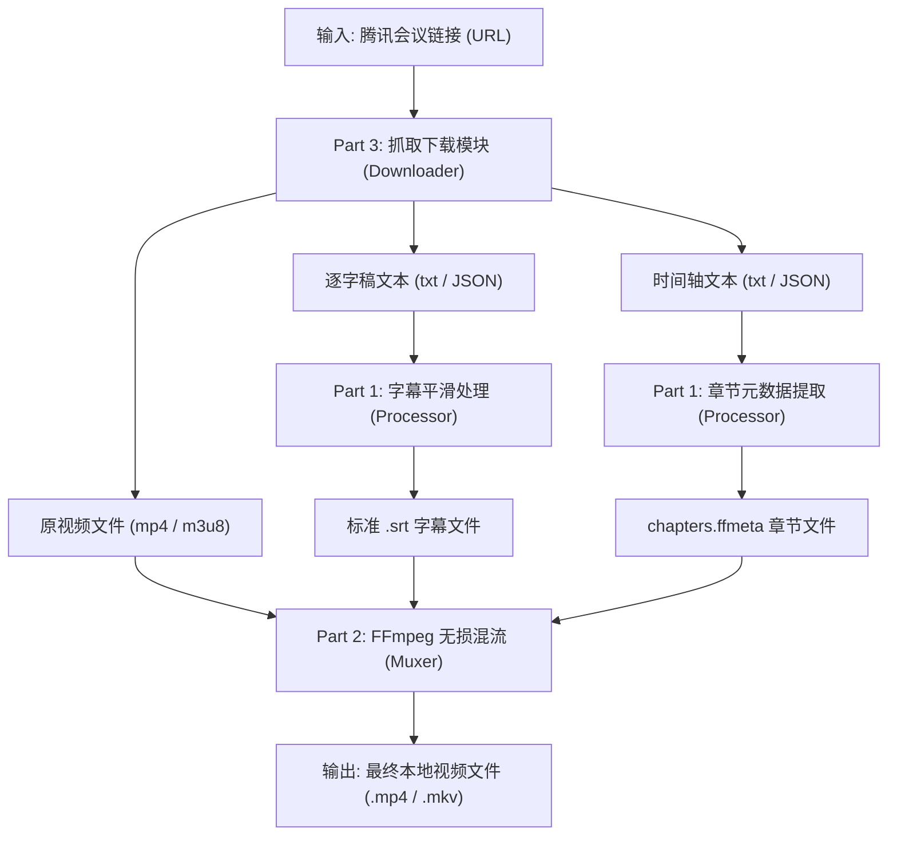

# 腾讯会议链接转视频 (link2video) 项目规划

## 一、 项目背景与最终目标

### 1. 背景与痛点
- 团队内部经常有重要的技术分享或会议录制在腾讯会议上。
- 由于腾讯会议录制文件的有效期限制，会员过期或分享到期后将无法查看。
- 网页版虽支持导出视频、逐字稿与时间线，但操作繁琐，且下载后三者相互割裂，无法提供良好的观影与复习体验。

### 2. 最终目标
开发一个 Python 命令行工具（未来发布为 PyPI 包，如 `link2video`）：
- **输入**：腾讯会议云录制分享链接（同时支持本地文件兜底模式）。
- **输出**：一个高质量本地视频文件（`.mp4` 或 `.mkv`），自带**可开关的软字幕**（中文转写）与**可点击跳转的章节标记**（Timeline）。

---

## 二、 系统架构与流程



---

## 三、 任务三部分拆解与独立验证方案

为了保证开发的高效与质量，项目划分为三个边界清晰、可完全独立测试与验证的部分。

---

### Part 1：字幕与章节数据处理引擎 (Processor)

- **定位与职责**：
  负责纯数据转换。将腾讯会议的“长段落逐字稿”与“时间线文本”处理成工业标准的字幕格式（`.srt`）与多媒体章节元数据格式（`.ffmeta`）。
- **输入与输出**：
  - **输入**：
    - 逐字稿文本（支持两种导出格式：`.md` 两行块格式 `姓名(HH:MM:SS):\n正文\n` 与 `.txt` 单行格式 `姓名(HH:MM:SS): 正文`）
    - 时间线文本（实测 `.md`/`.txt` 格式：`HH:MM:SS **标题。**正文`，末尾含 `内容由 AI 生成，仅供参考`）
    - 视频总时长（秒数 `--duration`，或直接传入 `--video` 自动探测 MP4/媒体时长）
  - **输出**：
    - `<name>.srt`（默认 `output.srt`，按语速与标点切分、时间不重叠的平滑字幕）
    - `<name>-chapters.ffmeta`（默认 `output-chapters.ffmeta`，标准的 `;FFMETADATA1` 章节标记文件）
- **核心逻辑**：
  - 中文标点断句与长度约束（单句 18 ~ 44 字符）。
  - 两段说话人间根据字数比例进行时间戳平滑插值，并约束相邻字幕起止时间不重叠。
  - 剥离 Markdown 加粗标记 `**...**`，提取时间线首句（<=32 字符）作为章节标题，计算起止毫秒时间戳。
  - 兼容 UTF-8 BOM，未匹配行跳过并输出统计信息，输入缺失或空解析直接报错。

#### 🛠️ 独立验证方案（无需网络、无需 FFmpeg）
1. **运行自动化单元测试**（含 `material/` 真实逐字稿、时间轴与 MP4 端到端验证）：
   ```bash
   python -m unittest discover -s tests -v
   ```
2. **使用 `material/` 真实数据执行 CLI 验证**：
   ```bash
   python -m link2video.processor \
     -t "material/20261106184953-CPU Weekly Sharing Session W3-逐字稿文本-1.md" \
     -l "material/20261106184953-CPU Weekly Sharing Session W3-时间轴文本-1.md" \
     -v "material/20261106184953-CPU Weekly Sharing Session W3-视频-1-共享屏幕.mp4" \
     -o ./output/ --name real_w3
   ```
3. **验收标准**：
   - 12 项单元测试全部通过。
   - 检查 `./output/real_w3.srt`：共 1472 条字幕，时间格式为 `00:01:16,000 --> 00:02:06,446`，字数适中，时间戳递增不重叠。
   - 检查 `./output/real_w3-chapters.ffmeta`：包含 `;FFMETADATA1` 标识和 12 个 `[CHAPTER]` 块，`START/END` 为对应毫秒值，标题无残留 `**`。

---

### Part 2：FFmpeg 媒体封装与元数据注入引擎 (Muxer)

- **定位与职责**：
  负责多媒体底层封装。调用 FFmpeg 工具，将任意已有的视频轨、音频轨、`.srt` 字幕轨和 `.ffmeta` 章节文件无损合成为单一最终视频文件。
- **输入与输出**：
  - **输入**：`video.mp4`、`subtitles.srt`、`chapters.ffmeta`、输出文件名。
  - **输出**：封装好的 `merged.mp4` 或 `merged.mkv`。
- **核心逻辑**：
  - 检查系统环境是否已安装 `ffmpeg`（当前环境未安装，执行 Part 2 前需先安装 `ffmpeg`）。
  - 执行显式流映射与流拷贝命令（零转码、无损画质，具体耗时与播放器兼容性待实测验证）：
    ```bash
    ffmpeg -y -i input.mp4 -i chapters.ffmeta -i subtitles.srt \
      -map 0:v -map 0:a? -map 2:0 \
      -map_metadata 1 -map_chapters 1 \
      -c:v copy -c:a copy \
      -c:s mov_text \
      -metadata:s:s:0 language=chi -metadata:s:s:0 title="中文字幕" \
      output.mp4
    ```
    *(注：`.mkv` 容器可使用 `-c:s srt` 对比播放器兼容性)*

#### 🛠️ 独立验证方案（无需真实下载大视频、无需爬虫）
1. **生成 10 秒空测试视频**：
   直接用 FFmpeg 生成 10 秒的标准色块测试源文件：
   ```bash
   ffmpeg -y -f lavfi -i testsrc=duration=10:size=640x360:rate=30 -f lavfi -i sine=duration=10 test_video.mp4
   ```
2. **执行独立混流测试**（使用 `material/` 真实视频或 10 秒空测试视频 + Part 1 生成的文件）：
   ```bash
   python -m link2video.muxer --video "material/20261106184953-CPU Weekly Sharing Session W3-视频-1-共享屏幕.mp4" --srt ./output/real_w3.srt --meta ./output/real_w3-chapters.ffmeta -o ./output/real_w3_merged.mp4
   ```
3. **验收标准**：
   - 运行 `ffprobe merged_output.mp4`：
     - 看到字幕流：`Stream #0:2(chi): Subtitle: mov_text`。
     - 看到章节标记：`Chapter #0:0: start 0.000000, end ...`。
   - 使用 VLC、IINA、PotPlayer 打开播放：
     - 播放器进度条出现分段章节节点，且能点击跳段。
     - 开启字幕菜单可正常开关中文字幕。

---

### Part 3：腾讯会议链接解析下载与端到端 CLI 工具 (Fetcher & CLI)

- **定位与职责**：
  负责最外层与用户的交互、URL 网页/接口解析下载、整体流程调度，以及 PyPI 打包发布支持。
- **输入与输出**：
  - **输入**：腾讯会议分享 URL（或本地文件路径）以及命令行参数。
  - **输出**：工作目录下的最终合成视频。
- **核心逻辑**：
  - **下载模块 (`downloader.py`)**：
    - 解析腾讯会议回放页（具体 API 接口与鉴权机制待抓包实测确定），获取视频流下载地址（需处理多视角视频变体，如合成视图/共享屏幕/说话人）。
    - 抓取逐字稿与时间线文本/数据内容。
    - **本地文件模式（扩展设计，非原 demand 显式要求）**：支持 `--local` / 指定本地导出目录（如 `material/` 中的导出文件），直接走 Part 1 + Part 2 完成合成，提高工具实用性与兜底能力。
  - **调度与 CLI (`cli.py`)**：
    - 串联全流程：`URL下载 -> Part 1 转换 -> Part 2 混流 -> 清理临时文件`。
    - 友好进度提示与日志打印。
  - **PyPI 打包支持**：
    - 配置标准 `pyproject.toml`（基于 hatchling 或 setuptools）。
    - 注册入口点命令：`link2video = "link2video.cli:main"`。
    - 参考 GitHub Actions 流水线，实现打了 tag 自动发布 PyPI。

#### 🛠️ 独立验证方案
1. **下载模块独立测试**：
   传入真实可公开访问的测试链接：
   ```bash
   python -m link2video.downloader --url "<腾讯会议录屏分享链接>" --output-dir ./temp_raw/
   ```
   检查 `./temp_raw/` 下是否正常拿到视频源文件、逐字稿文本和时间线文本。
2. **端到端一键闭环测试**：
   执行整合命令：
   ```bash
   link2video "<腾讯会议录屏分享链接>" -o ./output/my_meeting.mp4
   ```
   检查最终视频是否完整可播放。
3. **安装与发包测试**：
   通过 `pip install -e .` 或构建 wheel 包本地安装，验证 `link2video --help` 命令可用。

---

## 四、 推荐执行顺序

| 步骤 | 任务名称 | 依赖与风险 | 预期产出 |
| :--- | :--- | :--- | :--- |
| **Step 1** | **重构 Part 1：数据转换引擎** | 无外部依赖 / 极低风险 | 独立且健壮的 `processor.py` 及单元测试 |
| **Step 2** | **实现 Part 2：FFmpeg 混流引擎** | 仅依赖 ffmpeg / 极低风险 | 独立的 `muxer.py` 混流模块及测试脚本 |
| **Step 3** | **实现 Part 3：链接下载与 CLI 联动** | 依赖网络接口 / 中等风险 | `downloader.py`、`cli.py` 与 `pyproject.toml` |
